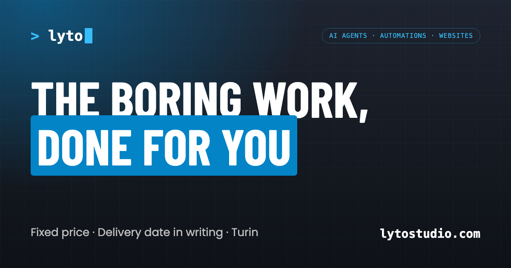

# lyto studio · [lytostudio.com](https://lytostudio.com)

**EN** — The website of **lyto studio**, the small studio of Erica Torta and Abderrahman Lyassi (Turin, Italy): websites, AI automations and voice assistants for small businesses.

**IT** — Il sito di **lyto studio**, il piccolo studio di Erica Torta e Abderrahman Lyassi (Torino): siti web, automazioni con l'AI e assistenti vocali per piccole attività.

## What's inside · Cosa c'è dentro

- Static site, no framework: hand-written HTML, CSS and JavaScript
- Bilingual EN/IT on one page: language from `?lang`, then the saved choice, then the browser
- Short links `/en` and `/it` (`_redirects`)
- Call booking with a Cal.com pop-up, loaded only on click
- Contact form with an email fallback
- Privacy policy in EN and IT; no cookies, so no banner
- SEO basics: `sitemap.xml`, `robots.txt`, Open Graph image, web manifest
- Hosted on Cloudflare Pages with a custom domain

## Note

The DIN Condensed font is licensed and not included here: the site uses it only if it is installed on the device.

© 2026 Erica Torta & Abderrahman Lyassi. All rights reserved. The code is public to show our work, not to be reused.
Il codice è pubblico per mostrare il nostro lavoro, non per essere riutilizzato.
